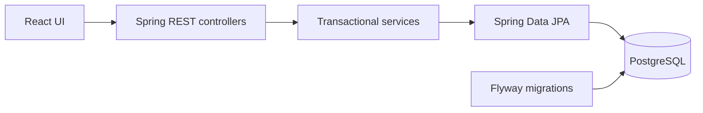

# Agentic Formdesk

A form workspace built with **React + TypeScript**, **Java Spring Boot**, **Spring Data JPA**, and **PostgreSQL**. Fill a contact form, save a draft, submit it, and manage saved records through the UI or REST API.

The repository includes instructions and verification workflows for coding agents. Printing Press integration and automatic form filling from screenshots are planned separately.

## What works

- Incomplete drafts that can be reloaded and completed.
- Server-side validation, field errors, and submission receipts.
- A searchable, paginated inbox with status filters and record details.
- Draft editing, deletion confirmation, and CSV export.
- PostgreSQL persistence with Flyway migrations.
- Swagger UI and an OpenAPI description for future CLI integration.

Submitting a form stores it in the database; it does not send an email.

## Project structure

```text
formdesk/
├── formdesk-ui/             React application, typed API client, UI tests
│   ├── AGENTS.md
│   ├── src/
│   └── package.json
├── formdesk-backend/        Spring Boot, JPA, migrations, API tests
│   ├── AGENTS.md
│   ├── src/main/
│   ├── src/test/
│   └── pom.xml
├── AGENTS.md                Repository-wide agent instructions
├── .agents/skills/          Specification, testing, verification workflows
├── .guidelines/             React, Java, and Spring conventions
├── .github/                 CI workflow and pull-request template
├── docs/specs/              Maintained behavior and API contracts
├── scripts/verify.sh        Shared local and CI verification
└── compose.yaml             PostgreSQL and optional full container stack
```



The browser communicates with the Java API. The backend owns validation and persistence; the UI never connects directly to PostgreSQL.

## Get started

Clone into a folder named `formdesk`:

```bash
git clone https://github.com/Harsha-T-G/agentic-formdesk.git formdesk
cd formdesk
```

Choose one way to run the application.

### Docker: all services

Requires Docker with Compose.

```bash
docker compose --profile full up --build -d
```

### Local development: React and Java, Docker for PostgreSQL

Use Node 24 (`.nvmrc`), npm, Java 21 or newer supported by Spring Boot 3.5, Maven 3.6.3+, and Docker. The Java source compiles for Java 21.

From the repository root:

```bash
docker compose up -d db
```

Start the backend in one terminal:

```bash
mvn -f formdesk-backend/pom.xml spring-boot:run
```

Start the UI in another terminal, also from the repository root:

```bash
npm --prefix formdesk-ui ci
npm --prefix formdesk-ui run dev
```

| Service | Address |
| --- | --- |
| Application | [127.0.0.1:5173](http://127.0.0.1:5173) |
| API health | [127.0.0.1:8080/api/v1/health](http://127.0.0.1:8080/api/v1/health) |
| Swagger UI | [127.0.0.1:8080/api-docs](http://127.0.0.1:8080/api-docs) |
| OpenAPI JSON | [127.0.0.1:8080/openapi.json](http://127.0.0.1:8080/openapi.json) |
| PostgreSQL | `127.0.0.1:5434`, database/user `formdesk` |

Vite proxies API requests to Spring Boot. Both run modes use the same host ports; stop one before starting the other. Stop native development servers with Ctrl+C in their terminals.

## Database and configuration

PostgreSQL uses the persistent Docker volume `formdesk_formdesk-postgres`. Stop containers while retaining records with:

```bash
docker compose --profile full down
```

Adding `-v` removes the database volume and its data.

Flyway migrations live in [formdesk-backend/src/main/resources/db/migration](formdesk-backend/src/main/resources/db/migration). Hibernate validates the schema with `ddl-auto: validate`.

| Environment variable | Default / purpose |
| --- | --- |
| `DB_URL` | `jdbc:postgresql://127.0.0.1:5434/formdesk` for native Java |
| `DB_USERNAME` | `formdesk` |
| `DB_PASSWORD` | `formdesk_local`, a local development default |
| `DB_PORT` | `5434`, Docker host database port |
| `SERVER_ADDRESS` / `SERVER_PORT` | `127.0.0.1` / `8080` for native Java |
| `FRONTEND_ORIGINS` | `http://127.0.0.1:5173,http://localhost:5173` |
| `API_PROXY_TARGET` | `http://127.0.0.1:8080` for the Vite proxy |

Use [.env.example](.env.example) as a template for optional Compose overrides. Java does not automatically read Compose's `.env`: export native backend overrides in its terminal. If you change `DB_PORT`, update native Java's `DB_URL` too. A password override initializes a new PostgreSQL volume; it does not rotate the password in an existing database.

## API

The [form-submission specification](docs/specs/form-submissions.md) defines lifecycle rules, errors, and acceptance criteria. Swagger describes the runnable endpoints.

```bash
curl http://127.0.0.1:8080/api/v1/submissions \
  -H 'Content-Type: application/json' \
  -d '{"status":"draft","first_name":"Alex"}'
```

Use the returned UUID to read or PATCH the draft at `/api/v1/submissions/{id}`. Complete it by supplying the required fields and `"status":"submitted"`.

JSON uses `snake_case` fields and `data` response envelopes. Lists add pagination under `meta`. The API supports list/search, create, read, update, delete, form metadata, and CSV export.

## Verification

Run the same commands used by CI from the repository root:

```bash
./scripts/verify.sh ui
./scripts/verify.sh backend
# Or both:
./scripts/verify.sh all
```

The UI command installs the npm lockfile, runs Vitest, checks strict TypeScript, and builds production assets. The backend command validates Compose and runs `mvn verify`, including tests against disposable PostgreSQL containers. Docker must be running. The script discovers Docker Desktop's per-user socket on macOS when `DOCKER_HOST` is unset.

CI uses Node 24 and Java 21, separate UI/backend jobs, read-only repository permissions, and pinned GitHub Actions. The project does not currently configure ESLint, a Java static analyzer, or coverage thresholds.

Backend tests use their own database, never the development volume. UI interaction changes also need a browser check; passing a build does not verify the whole user experience.

## Working with coding agents

Start with [AGENTS.md](AGENTS.md), then the affected module's instructions. Agents that do not automatically load these files should read them explicitly.

- [Formdesk specification workflow](.agents/skills/formdesk-spec/SKILL.md): define or update a material behavior/API change.
- [Formdesk test workflow](.agents/skills/formdesk-tdd/SKILL.md): reproduce behavior with a focused test, implement, then refactor.
- [Formdesk verification workflow](.agents/skills/formdesk-verify/SKILL.md): check the contract, run the relevant gates, and inspect repository hygiene.

The maintained specification and stack guidance are the documentation intended for version control. Local archives, design scratch files, screenshots, temporary reports, database files, and build output are ignored.

## Current boundaries

This is a personal local application with no login or record-ownership model. Services bind to loopback by default. Authentication, authorization, and deployment controls are required before remote exposure.

Printing Press has not been connected. The existing OpenAPI endpoint is the starting point for that later integration; a generated CLI would call the same Java API used by React.
